<div align="center">

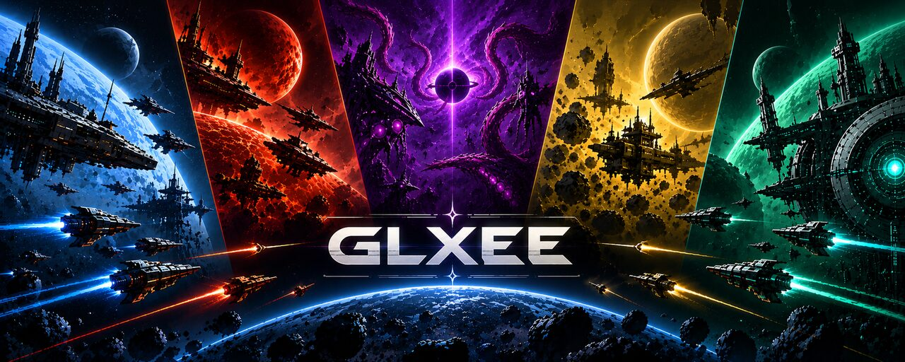

# GLXEE

**Open the hatch. Own the lane. Make the next jump count.**

A no-build, browser-native space shooter in a living shell — five doctrines at
war across contested galaxies, modular hulls forged in the hangar, chiptune
lanes that remix per planet and foe, and a Home Station that keeps every scrap
you haul back through the dark.

[](#boot)
[](#credits)
[](#credits)
[](#factions-and-galaxies)
[](https://meierdesigns.itch.io/glxee)

</div>

**Play free in the browser:** [meierdesigns.itch.io/glxee](https://meierdesigns.itch.io/glxee)

GLXEE is not a palette swap of the same ship. Identity rides on **pixel shape**:
Terran plates, Kronax claws, Voidborn rings, Pirate scrap, Machine grids — each
faction writes its own silhouette, enemy pool, planet crust, and bezel chrome.
You assemble area-sized modules, clear stages under fire, sign contracts that
move galaxies, and jump again before the lane goes quiet.

```text
╭────────────────────────────── VOLTEX CHANNEL ──────────────────────────────╮
│  SIGNAL          UGDF ARCHIVE · COMBAT SIMULATOR ONLINE                     │
│  BUILD           1.14.12 · TRACKER LIVE · VOICES 300% · FAST BPM BODY         │
│  PILOT STATUS    CLEARED FOR LAUNCH                                         │
│  THEATER         MILKY WAY · MARS · CONTESTED                                │
│  LOADOUT         NOSE  M   CORE  S   AFT  M   WINGS  S/S                    │
│  AUDIO           STYLE · AMOUNT · SPEED · VOICES · PLANET × FACTION VFTRACK │
│  OBJECTIVE       CLEAR THE STAGE · SCOOP SALVAGE · HOLD THE LANE            │
│  NEXT JUMP       HOME STATION → TRAVEL → UNKNOWN SECTOR                     │
│  WARNING         EVERY SILHOUETTE ON SCAN IS A DOCTRINE                     │
│  PLAY            https://meierdesigns.itch.io/glxee                         │
╰─────────────────────────────────────────────────────────────────────────────╯
```

<div align="center">

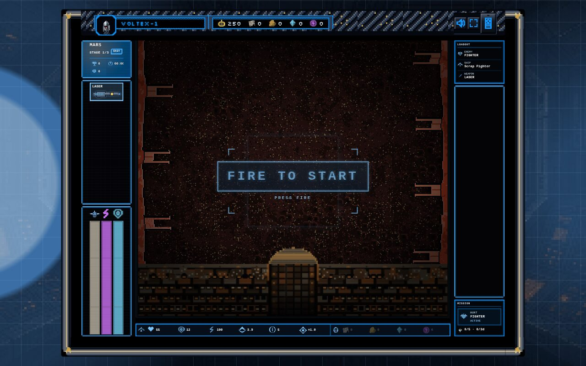

<br/>

`COMBAT  ·  MARS STAGE  ·  WEAPON CARD  ·  ENEMY HERO CARD`

<br/>

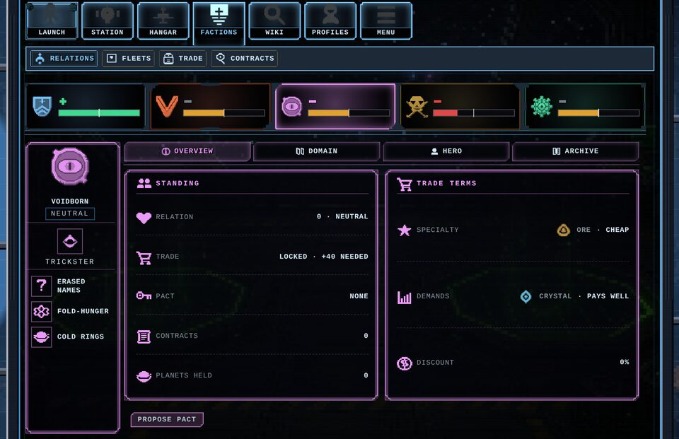

<br/>

`FACTIONS  ·  RELATIONS  ·  TRADE  ·  CONTRACTS`

</div>

> **Design rule:** the README follows the game loop. Boot and controls come
> first, systems are described once in their owning section, and development
> history stays at the end.

## Contents

- [Boot](#boot)
- [Controls](#controls)
- [The game loop](#the-game-loop)
- [Factions and galaxies](#factions-and-galaxies)
- [Home Station and hangar](#home-station-and-hangar)
- [Combat](#combat)
- [Audio — VF Tracker and environment SFX](#audio--vf-tracker-and-environment-sfx)
- [Screenshots](#screenshots)
- [Features](#features)
- [Architecture](#architecture)
- [Development waves](#development-waves)
- [Documentation](#documentation)
- [Lore](#lore)
- [Credits](#credits)


## Boot

Requirements: **Python 3**. There is no build step and no dependency install.

```bash
npm start
# http://localhost:3000
```

`npm start` / `npm run dev` / `npm run serve` run `tools/dev-server.py`: a threaded
**HTTP/1.1** static server with keep-alive (the page pulls hundreds of files),
quiet request logs, **gzip** for HTML/JS/CSS/JSON/SVG, and per-file cache headers:
JS/CSS/fonts stamped `?v=<mtime>` are cached `immutable` (no round trip on F5),
images revalidate (`max-age=0, must-revalidate` → cheap 304), everything else
sends `no-cache` so edits still appear. On each server start a one-shot
`Clear-Site-Data: cache` plus cookie `vfboot` wipes stale immutable entries;
browsers that ignore that header can hard-refresh with **Ctrl/Cmd+Shift+R**
(hits `/__cache-clear`). Equivalent plain server (no stamps/gzip):

```bash
python3 -m http.server 3000
```

Silkscreen is **self-hosted** under `assets/fonts/` (no Google Fonts round trip),
preloaded in `index.html`, and declared in `css/fonts.css`. A solid **boot veil**
covers the shell until the start menu is restored.

`js/core/stage-boot.js` runs in `<head>` and locks a fixed **1280×960 (4:3)**
logical stage plus `--stage-scale` before first paint, sizing the stage to
**95 %** of the window (same fill rule as `viewport-fit.js`). The last known
faction styles the outer **bezel** immediately (`data-vf-faction`), and
`vf-loading` holds transitions off until load settles. Cached **GUI voxel** and
**pixel-frame** look apply before first paint so the bezel never starts smooth
and then snaps.

A **loading screen** paints with the first frame (critical CSS in `index.html`):
GLXEE brand, VOLTEX channel line, progress bar, and phase status
(`OPENING CHANNEL` → `LINKING SYSTEMS` → `FONT LOCK` → `RESTORING MENU`).
`js/core/boot-loader.js` tracks stylesheet/script resource progress; `GameCore`
advances phases while restoring the menu, then fades the veil out. On a plain
**refresh** in the same tab session the progress panel stays hidden — only a
calm veil covers the stage (under the bezel) so the UI never visibly rebuilds.

**Cold load vs refresh:** `stage-boot.js` sets `data-vf-load` on `<html>` before
anything else loads. `cold` (first visit, a new build stamp, or a navigation that
is not a reload) shows the progress panel and waits for sprites and the font;
`refresh` (same build stamp in `localStorage['vf-build']`, reload or same tab)
keeps only the calm veil and skips the sprite wait and shortens the font wait.
The build stamp is `vf-boot` (server start id) plus the `?v=` of the `css/styles/part-*.css` links;
it is stored when boot finishes.
The same script reads the saved menu state and preloads the destination
background art (`menu-hangar-bg` or the matching `hs-bg-*`) in parallel with the
scripts, so the art behind the bezel is ready when the veil lifts.

Optional local tools:

```bash
npm run build:bundle    # rebuild deferred.js + deferred-editors.js
npm run ship:audit      # tracked file count vs ~800 / 1000 cap
npm run assets          # ComfyUI + asset-gen bridge
npm run comfy           # ComfyUI workflows
npm run asset-gen       # asset-gen bridge on :8787
npm run icons:preview   # render icon previews
```

Run the server from the repository root.

The repository itself is the itch.io runtime package: the GitHub download
contains the game entry point, runtime code, CSS, and game assets (kept near
~800 tracked files, well below GitHub's 1000-file download cap). README media,
development-only archive/package sources, local Cursed bridge packages, and
unreferenced generated sprite dumps (`assets/{levels,ships,weapons}/sprites/`)
are excluded from the itch upload. Version archives under `.claude/` are local
only and never nested inside the download ZIP. DevMode editors load from
`js/bundles/deferred-editors.js` on demand (`ensureVfEditors`).


## Controls

| Input | Action |
|:------|:-------|
| Arrow keys / WASD | Move |
| Space | Fire; hold to charge |
| Shift | Charge Drive boost |
| Q / E | Cycle weapons |
| Escape | Pause; switch menu groups in the station |
| Gamepad | Stick move; LB/RB/LT/RT = A/S/D/Space fire; L3 boost; R3 shot type; Start pause; menu cursor |
| Ctrl + 1–8 | Select color palette |
| `#` or Settings → Assets | Open Asset Generator |
| Settings → Faction | Open Faction Command |
| Bezel FX → AUDIO | Master / sounds / music; STYLE · AMOUNT · SPEED · channel voices |

Menu navigation is keyboard-first: arrow keys move focus, Enter confirms, and
Escape closes the active overlay. A gamepad drives the same focus path with an
animated HUD cursor. On **LAUNCH**, ↓/Enter drops into the map, arrows move
between planets at resting stations (not orbiting posts), ↓/Enter opens the
planet card (stages → actions), and Escape climbs back out. Text fields keep
their normal caret controls.

## The game loop

```text
Choose your doctrine
    ↓
Forge the hull at Home Station — upgrade · shop · craft · hangar · factions
    ↓
Accept a planet strike, faction contract, or bounty hunt
    ↓
Travel / launch → clear the stage → scoop salvage → sluice out
    ↓
Victory trader (optional) · refit · trade · rewrite the loadout · jump again
```

A mission is either a **LIBERATE** run on an uncleared planet or a lower-paying
**PATROL** on a cleared one. One mission can be active at a time. Faction
contracts can target reachable galaxies and may teleport the pilot before launch.
Stage boot crossfades straight into the planet×faction combat vftrack loop
(no separate intro fanfare cut); wrecks can drop salvage you must scoop before
the sluice.


## Factions and galaxies

Five factions define the main theaters. Their silhouette rules, procedural planet
styles, enemy pools, and strategic goals are shared by combat and exploration.

| Faction | Galaxy | Silhouette language | Doctrine |
|:--------|:-------|:--------------------|:---------|
| **Terran** | Milky Way | Modular plates | Engineers, escorts, safe lanes |
| **Kronax** | Andromeda | Claws and spikes | Ambush, speed, war packs |
| **Voidborn** | Void Reach | Broken rings | Fold-space, silent fleets |
| **Pirate** | Scrap Belt | Asymmetric scrap | Salvage, black docks, mutiny |
| **Machine** | Synth Grid | Circuit grids | Logic, forge nodes, replication |

Foreign galaxies begin with generated arrival sectors. Faction themes seed
planet names, obstacle doctrine, enemy compositions, icons, and background
patterns. Reputation ranges from -100 to +100; allegiance, pacts, and contracts
change whether a faction trades and which prices it offers.

<div align="center">

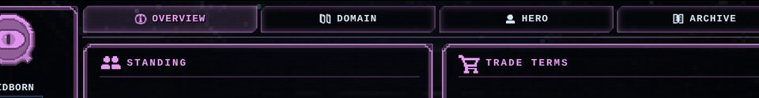

<br/>

`TERRAN` · `KRONAX` · `VOIDBORN` · `PIRATE` · `MACHINE`

<br/>

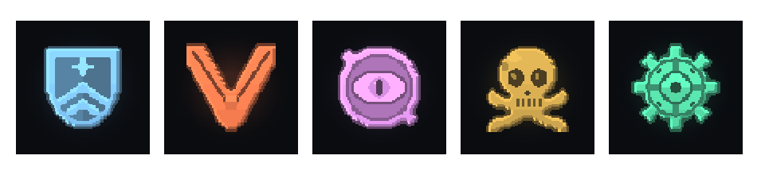

<br/>


<br/>

`MARS` · `JUPITER` · `SATURN` · `NEPTUNE` · `PLUTO`

</div>

Large UI surfaces (crest, relations cards, profile modal) draw **hand-shaded
32×32 emblems** through the `@2x` / `@4x` icon path instead of a blocky upscale
of the 16×16 silhouettes. Resource chips use the same hi-res treatment. The
Pirate seal is an angular void-skull over crossed boarding cleavers — harsh on
both the 16px HUD badge and the enlarged `@4x` crest.

### Faction relations and contracts

The Home Station Factions area has focused views:

- **Relations:** reputation meter, allegiance, pacts, controlled planets, and lore.
- **Fleets:** live formation preview with zoom; the pilot's ship fights back at
  the bottom. Faction colour overrides update the preview live; a **player-only**
  filter focuses the active hull.
- **Trade:** faction specialties, demanded resources, buy/sell quotes, and relation discounts.
- **Contracts:** faction jobs and bounty hunts in reachable galaxies.

Contracts pay credits and materials when the target planet stage is cleared and
raise reputation with the issuing faction.

### Galactic control

Each galaxy has a faction ruler, a hidden base, and a faction-specific expansion
pattern. Flights and cleared battles advance the control simulation:

- factions found outposts, war camps, sanctums, hideouts, or relays;
- holdings add defenders and faction-specific parts to their trading stations;
- stations can be raided, and destroying every station exposes the base;
- destroying the base changes a held galaxy to contested control;
- a new profile begins with a seeded home-galaxy invasion that can be repelled
  for an opening reward.

**Shared world ownership:** clearing a planet claims it for the pilot's faction
in a global `galaxy.owners` map (latest clear wins). Holding more than half of
a galaxy's planets makes that faction the ruler for every pilot; rivals keep
the galaxy **CONTESTED**. Built-in control presets bump with `GALAXY_CONTROL_REV`
so saved galaxies pick up new ally/rival rules.

**Ally defense:** when an allied faction's home galaxy is invaded by a common
enemy, the pilot can fly there to repel it for bonus credits, scrap, and
reputation with the ally.

**Custom galaxies:** the main-menu **GALAXIES** viewer browses every shared
galaxy (ruler emblems, map, planets). Pilots can generate a named start galaxy
at creation (planet count, difficulty tier, suns, rivals) or open NEW GALAXY
from the viewer; unused generated galaxies can be deleted. The viewer remembers
selected focus and column scroll positions across sessions.

**Universe save:** from the GALAXIES viewer, download or upload a single
`glxee-universe-*.json` that packages every galaxy, planet config, custom
cluster/pattern, faction state, and pilot profile. Restoring writes the same
localStorage keys the managers use and reloads cleanly.

Trading posts remember which faction **built** them (`stationBuilders`), so a
post keeps its builder's look after the anchor planet changes hands. Posts are
placed with edge awareness so they sit on reachable lanes.

Planet cards on the explore map show atmosphere haze from the live SVG palette.
Map art is built from a shared **pixel unit**: planets, suns, and nebula cells
use one pixel size per zoom step, and planet size classes add pixels instead of
making pixels bigger. Suns carry a noise surface that gains octaves when you zoom.
Nebulae are posterised into hard steps (no smooth gradients), mix coarse and fine
grain, keep dark voids and translucent veils, and glow on their own in a few
pockets; only some suns carry a nebula and its colour follows the sun while
brightness falls with distance. Free-floating vortices are static. The coarse
field is stored in the browser per galaxy and prepared at boot, so a reload
shows it at once; fine patches snap to a tile grid so small pans reuse finished
work. Stage counts under planets show on hover only. Border **checkpoints** use faction silhouette
art. Route beams carry **bidirectional data-packet traffic**. A **ship locator**
recenters the map. Explore budget sits in a progress chip; the **ruler bar**
stacks planet / situation / action segments. Selecting a border, planet, or
station updates the confirm row:

| Selection | Actions |
|:----------|:--------|
| Locked border / planet | Disabled lock button |
| Open planet | **FLY TO** the theater |
| Friendly / trade station | **DOCK** |
| Hostile station | **RAID** (+ fly-away) |
| Exposed faction base | **ASSAULT BASE** |
| Checkpoint border | Jump to the planet whose clear opens it |


## Home Station and hangar

The station is the progression hub:

| Area | Purpose |
|:-----|:--------|
| Station | Overview, resource silos, cargo bay, and current status |
| Upgrade | Hull-area and slot-size upgrades |
| Hangar | Ship editor, loadout, inventory grid, and test arena |
| Equipment | Per-item upgrades with ship/station storage select |
| Shop | Ships, blueprints, modules, and style unlocks |
| Craft | Unlock hulls and equipment from blueprints |
| Explorations | Ships, planets, enemies, factions, and events |
| Missions | Liberate / patrol board, story logbook, and rewards |
| Factions | Relations, trade quotes, contracts, and fleet previews |

**PLAY** is a dedicated header launch button (and a matching main-menu control)
that drops straight onto the galaxy map — not a station sub-tab. Area tabs carry
corner deco icons so HOME STATION, HANGAR, FACTIONS, and EXPLORATIONS read as
distinct hubs. Travel remains a modal over PLAY and is never restored after a
reload.

**Station storage** is a growing vault grid (starts 6×2, expands with vault
upgrades) beside **OWNED SHIPS**. Parts and blueprints file as **ship storage**
or **station storage** independently of equip state. Inventory tiles render as
seeded **physical metal casings**; equip / unequip plays a short pop or sweep.
Resource stores are vertical **chamber silos** with level fill and capacity marks.

### Browser shell, stage, and resolution

The whole app lives on a fixed **4:3 stage** (logical 1280×960). Viewport fit
scales that stage uniformly to fill **95 %** of the window (width or height,
whichever limits first) so proportions never change. An outer **faction bezel**
frames the stage using a shared **screen-frame** mechanic (`css/screen-frame.css`):
stacked plates clipped to `--fr-shape` form the bevel so each faction only
supplies silhouette tokens and colours. Optional **pixel-frame** mode rasterises
that silhouette onto a lattice with lit/shade edges. Per-faction bevel / hull
colours are editable and persisted. Cable plugs reach into the screen opening.
The top strip holds **RES**, **FX** (visual settings), fullscreen, logout, and a
two-screen **pilot HUD** (`css/pilot-hud.css`). Ship render defaults to **VOXEL**.
Faction colour tokens cross-fade on switch (`@property` typed colours).

Home Station still uses `.vf-browser-shell` inside the stage. The area-tab row
(including PLAY) aligns to the first content panel below it. When an area has no
sub-nav (e.g. PROFILES), the active card bridges into the body box. Tooltips skip
controls that already show their own label. Mobile-narrow layouts allow PLAY to
wrap full-width under the header.

### Hull areas and slots

Every ship has four areas: **NOSE**, **CORE**, **AFT**, and **WINGS**.

- Area upgrades add slots and frame bonuses.
- Individual slots upgrade from **S → M → L**.
- Module upgrade costs ramp harder at late levels so endgame spends matter.
- Split wing mounts use mirrored half-size sockets.
- Weapon sockets can be dragged between nose, core, and wings when space allows.
- Area toggles can hide nose, aft, or wing sections and safely remap modules.
- The hangar Parts view shows inventory, fit status, slot size, and drag targets.
- Hangar areas use an **area pager** (one open NOSE/CORE/AFT/WINGS at a time)
  with prev/next pinned above the ship list instead of an accordion.
- Hangar bay zoom steps in whole pixels-per-voxel above 1× and shrinks smoothly
  below that (down to 12 %), with continuous easing while animating.
- Frame-edge resize keeps the grabbed handle under the pointer at every scale.
- Station storage columns (ships / blueprints / parts) are drag-resizable with
  remembered `fr` weights.
- The hangar bay has an **INVENTORY** panel on the left: a fixed 8-column grid
  of 48 px tiles, icon filters per part kind (weapon / defense / ability /
  energy), and drag & drop straight onto the ship's slots.
- Parts render as **physical items** (`physical-item.js`): a generated pixel
  casing per part instead of a flat glyph; the part icon lives in the compact
  tooltip (description first, key/value facts below).
- Equipping and unequipping play a short pop / sweep animation; installed items
  pulse and bob while hovered (disabled under `prefers-reduced-motion`).
- Station, menus, and fight share one **`.vf-glass`** host in the bezel opening:
  one transform recipe, undivided `--fr-open-*` insets, and a header that may
  peek under the metal band so the shell reads as one screen, not nested zooms.

The loadout is persistent per profile and per ship. It includes weapon mounts,
module offsets, slot upgrades, anatomy settings, cosmetic skins, wing variants,
connection settings, and disabled areas.

### Menu and profiles

The start menu leads with **NEW PILOT** and **LOAD** (LOAD locks when no
profiles exist), plus GALAXIES, settings, and credits. HD menu icons cover
new-pilot, floppy LOAD, hangar, factions, and explorations. Profile details use
stat tiles and per-galaxy progress cell bars; faction filters narrow the list.
An unfinished New Pilot flow (faction / name step) restores after reload.
Subtitle reads *…a MRDSN Production*.

The main menu is full-screen with the pilot's own **home station** drawn as the
backdrop (`station-backdrop.js`); menu and scoreboard sit left and right so the
station shows through the middle. Menu and station backgrounds are darkened with
a cheap black overlay (no fullscreen filter under the parallax), and the menu
buttons get a raised, high-contrast frame.

**New Pilot flow** runs faction → pilot → start setup. The pilot step shows the
faction crest left of the name field and a generated 96×108 pixel portrait of a
helmeted pilot (3/4 view, accent rim light) with sliders for skin, eyes, face,
nose, mouth, brow, scar, and gear; RANDOMIZE re-rolls it. The start-setup step
picks the start galaxy (generated galaxy icon) and starter kit. The chosen
portrait is stored on the profile and shown in the profile list and faction
hero cards. A procedural startup sound (Settings → Startup Sound) plays in the
boot intro.

### Galaxy map routes

Planet-to-planet routes are one smooth arc that bows just far enough to clear
obstacles (straight when the way is clear), start and end on the planet
surface, and preview as slow marching dashes. Each galaxy remembers its camera
and last selected planet or station. Stations orbit their planet and show only
once that planet is unlocked. A locked planet's hint names what to clear first
with a JUMP TO button.

The bottom bar shows the selected planet's enemy as a poster: planet name on
top, a framed `ENEMY` line with the faction emblem and its hero's name, and the
hero portrait (no backdrop) staggered with one of the faction's ships in front
of the planet. In dev mode, clicking the enemy card (or LAYOUT → ENEMY CARD
LAYOUT) opens a modal with a live copy of the bar: drag title, bar, face, ship
and planet, resize them (20–300 %) and set their layer. Settings persist per
browser; COPY AS DEFAULT exports them for the shipped defaults (`BAKED` in
`enemyCardLayout`).

<div align="center">


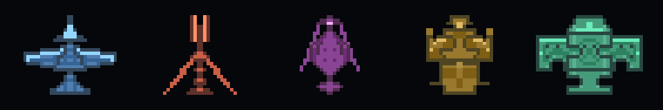

<br/>

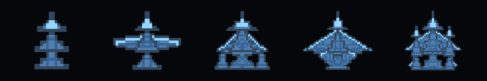

</div>


<div align="center">

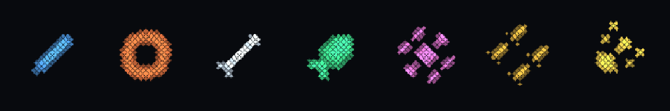

<br/>

`LASER` · `SPREAD` · `RAPID` · `PLASMA` · `MISSILE` · `ION`

</div>


## Combat

Combat is a vertical shooter with a readable pixel hierarchy:

- Five factions × five hostile classes: scout, assault, heavy, elite, capital.
- Faction silhouettes use topology and plating so shape communicates doctrine.
- Champions can announce escorts: repair drones, shield batteries, gunners,
  jammers, and tethers. Side-boss difficulty and faction boss kits are split so
  champion pressure scales independently of the main wave.
- **Scrolling terrain** walls carve flight lanes (canyons, narrows, teeth, reefs)
  tinted by the planet and the holding faction. Material weights mix rock,
  metal, **crystal**, and magma; crystals prism and shatter into shards.
- Rocks take **weapon-scaled damage**, splash, and shed collidable chunks; debris
  is visual-only chip FX in the rock's own colours.
- **Planet tiers** (Easy → Nightmare) scale enemy health, speed, damage, and spawn
  cadence so early theaters forgive and late ones punish.
- **Balance:** weapons use a role-budget Power score (laser = 1.0); menu difficulty,
  stage ramp, and shop prices track TTK bands (side ~2s / champion ~5s / boss ~22s).
- **Stage count** varies by planet difficulty (roughly 2–5 stages + boss); later
  stages raise terrain danger, ambient pressure, and kill-drop yield.
- Victory and defeat screens show an **outcome stepper** for the planet just
  fought (cleared / current WON·LOST / locked). A refresh restores the same
  end overlay (score / time / kills) instead of dumping back to the menu.
- **Boss stages** after the regular clear: multiphase patterns, escort calls, and
  a dedicated HP bar — bosses ignore the normal lane shooter loop. Each faction
  runs its own doctrine (Terran line volley, Pirate scrap storm, Kronax claw
  rush, Machine forge grid, Voidborn void rift) with unique movement and specials.
- **Supply crates** drop random timed power-ups: **POWER SHOT**, **RAPID FIRE**,
  or **BARRIER** (half damage taken), each with HUD notice and icon glow.
- Enemy waves use **seeded liveries** so ships of one faction still look distinct;
  renegade contract targets get outlaw markings (hazard slash, crossed badge).
- Normal and escort spawns **dive in from above**, then lock into cruise /
  formation slots. Active craft stay **fully inside** the playfield rim.
- **Field presence:** combat (shots, jammer, tether) only while fully on-screen.
  Entering and fleeing hulls do not fire; off-screen ships are culled so HUD bars
  and clear checks finish. Late / stuck escorts get a hard flee kick.
- Scheduled sides stop spawning once the objective is won or awaiting field clear.
- Faction contracts can spawn **renegade captains** or **outlaw gangs** with their
  own callsigns and paint.
- Ambush encounters can roll a raider boss, a pirate pack, or a light swarm.
- Weapons, abilities, shields, charge, drive, pickups, and explosion FX form the
  moment-to-moment combat layer. Hit bursts stay compact so silhouette reads.
- Enemy wrecks can shed **blueprint** and rarer **part** salvage pickups that
  must be scooped into cargo. Death forfeits them; victory teleports remaining
  salvage home to the station vault.
- Victory loot pays resources, credits, blueprint/part salvage, and active mission
  rewards; the scoop phase ends as soon as the field is clear (idle vacuum for
  stranded drops; bosses keep a longer safety net).
- **Victory trader:** after a clear, open the stage shop from the victory screen
  (credits-only buys queue for the next stage). Shelf size rolls each visit from
  how well you stand with the planet's resident faction. The old sluice-wall
  kiosk is gone.
- **Launch hatch:** every planet arrival starts in a pixel tube that rises out of
  the home station's hull; the dome opens on GO and the ship flies out. Later
  stages on the same planet start from a sluice instead.
- **Sluice exit:** planet stages no longer end on the last kill. A faction-styled
  gate (Terran steel, Machine bulkhead, Pirate scrap, Kronax bone, Voidborn
  flesh) scrolls in, its hatch dome is shot open, and the ship flies through.
  Hatch, sluice, warp, rock breaks, crystal shatter, pickups, and wall scrape
  fire as coded **environment SFX** on the sounds bus.
- **Chain waves:** Xenon-style lines of craft snake along one shared path,
  sometimes as two mirrored chains. Light classes (scout / assault / heavy)
  do one job and go down faster; side craft launch from canyon hangar openings.
- **Prism and bulwark obstacles:** prisms fan shots out on the shooter's side,
  indestructible bulwarks get shoved by shots and rammed into enemies. Enemies
  take cover in obstacle shadows and scrape the canyon walls like the player.
- **Enemy hero cards:** the stage's main enemy and elite / capital side craft get
  a sidebar card with a unique pilot portrait that reacts to hits (pain, anger,
  dead). Equipped weapons show as side-view pixel-art cards with charge cells.

<div align="center">

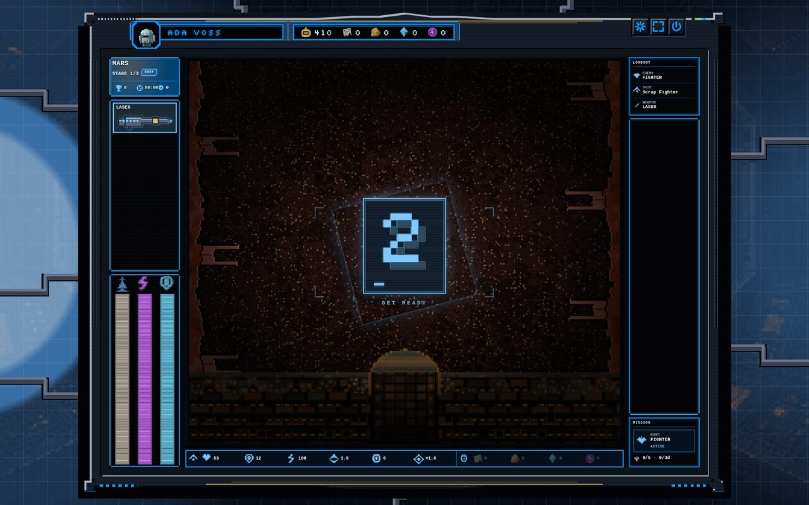

</div>

### Playfield and VOXEL combat

Viewport fit is **playfield-first**: the fight canvas takes nearly full column
height, aspect sets width, leftover width feeds clamped side HUD panels, and
VOXEL mode snaps CSS size to integer-divisor lattice steps.

Ship Render **FLAT** / **VOXEL** shares one combat lattice cell (settings
**Voxel Size** from 0.25–8). Ships, modules, terrain, obstacles, particles, and
debris snap to that cell; VOXEL lowers supersampling when cells are large.
Destroyed hulls shed **silhouette-sampled voxel chips** with a hot core burst.
**GUI voxel** can pixelate chrome lines independently of ship render style.

### Look FX and size overlay

Bezel **FX** and Settings expose glow, scanlines, CRT, chroma, **vignette**,
**noise**, **flicker**, **bloom**, and **HDR** (percent strength; area SCREEN /
FRAME / BOTH). Font sizes cover h1–small plus a separate **game HUD** scale;
families can override per size. The in-game **SIZES** overlay sets exact pixel
widths for player, enemy classes, and shots, plus shot-speed percent.

### Bezel remote — PERF and DEBUG

Open the bezel **FX remote** (corner tool) and switch to **PERF** or **DEBUG**.
Both tabs run a live probe (~2 Hz paint) while that tab is open:

| Readout | Meaning |
|:---|:---|
| **FPS** / **FRAME** | Shell RAF rate and ms per frame |
| **LOOP** | `IDLE` · `PARKED` · `COMBAT` · `PAUSED` |
| **PLAYFIELD** / **SCALE** / **BACKING PX** | Canvas backing store size and supersample |
| **GLOBAL PIXEL** | Map/combat Global Pixel Size (`OFF` when unset) |
| **JS HEAP** | Chrome `performance.memory` used / limit |
| **ENTITIES** | Enemies · bullets · particles · explosions |
| **MAP PX FILTER** | SVG `#vfMapPx` on the galaxy map (`ON` only when PERF heavy is on) |

**PERF** also keeps the effect switches (SWAY / CHROMA·BLOOM·CRT / FX ANIMATION /
FRAME PIXEL) and LOW · BALANCED · HIGH presets. **DEBUG** adds machine info
(CPU cores, device memory, DPR), load timing by area, slowest scripts, and
actions: **LOG / COPY PERF**, reload, clear local settings, log debug info.

Console: `vfPerfSnapshot()` returns the same object the remote paints.

### Audio — VF Tracker and environment SFX

Combat music is **VF Tracker** JSON (`*.vftrack.json` under `assets/soundtracks/`),
not a drone bed. Voices stay in a pulse / wave / noise palette (Volley Fire GB
era roles: Main-BGM, Boss, Select).

- **Hauptmelodie × STYLE**: each planet owns distinct motifs for **ingame**,
  **map**, **victory**, **lose**, **shop**, and **boss** (own siege hooks — not
  combat remixes). The selected **STYLE** interprets those pitches (rhythm /
  drums / articulation); it does not replace the hook.
- **Scene feel**: menu difficulty + planet tier nudge combat tempo / STYLE
  intensity (easy softer, hard/boss hotter); victory / lose / map / shop each
  have their own feel so the bus matches what just happened.
- **Planet × hostile faction** composition skins the combat loop; explored
  planets remix handcrafted motifs (blend / key / order) instead of random notes.
- **Intro fanfare** plays once on stage boot (`intro:` keys), then the loop.
- Hub **menu**, per-planet **map** / **victory** / **lose** / **shop** / **boss**
  roles are distinct; faction can still colour instruments on end screens.
- Multi-section arrangements (A / B / C / fill) and per-pattern faction drums
  keep long stages from looping flat.
- Same song keeps position across stage / override swaps; track changes
  **crossfade** (~1.4s) instead of hard cuts.
- Bezel FX → **AUDIO** (and settings): **STYLE** dropdown
  (PLANET · JUNGLE · MINIMAL · AMEN · REESE · NEURO · LIQUID · DNB · NIGHTRUN),
  **AMOUNT** intensity, **MUSIC SPEED** as a × multiplier (default 3.50× ≈
  old 462 reference BPM @ 132), and per-channel **voice** selects
  (BASS / LEAD / ARP / DRUMS). MINIMAL follows a dark-techno pulse
  ([Max Minimal reference](https://www.youtube.com/watch?v=mv8vJQaUpDU));
  NIGHTRUN is the darksynth / neon-highway head.
- Volume is a linear **MASTER × MUSIC** bus with gesture resume after browser
  autoplay blocks; station and menu restore the correct track on return.
- Dev **Soundtrack Editor** imports / exports vftrack files and ships an LLM
  prompt for Gemini-style editors (`assets/soundtracks/LLM_PROMPT.md`).
- DevMode **Music Editor** (local `js/ui/dev/`, not uploaded) lives on the bezel
  **AUDIO** remote always: narrow stacks settings above editor, wide is
  side-by-side; settings can collapse to editor-only. Edits STYLE rhythm /
  drum banks; overrides in localStorage. Melodies stay planet/role-owned.
- **Environment SFX** (`js/game/sounds/env-sfx.js`) cover sluice / hatch / warp,
  obstacle breaks, pickups, and wall scrape on the sounds bus (bezel FX → AUDIO).

## Screenshots

Live captures from the current build (pilot creation, mission start, combat,
station shell, factions, travel).

<div align="center">

| New pilot — faction | New pilot — portrait |
|:---:|:---:|
| 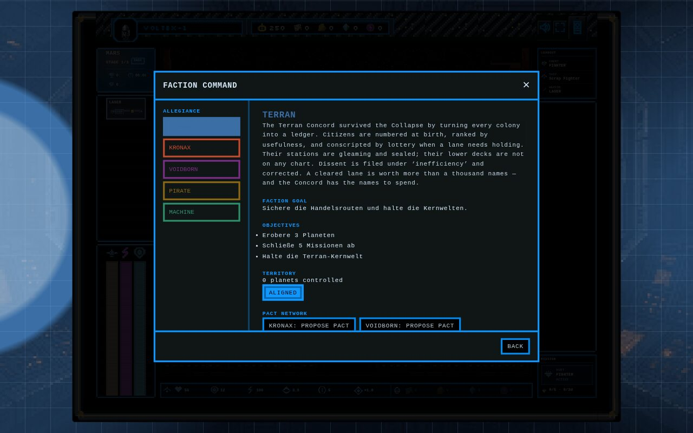 | 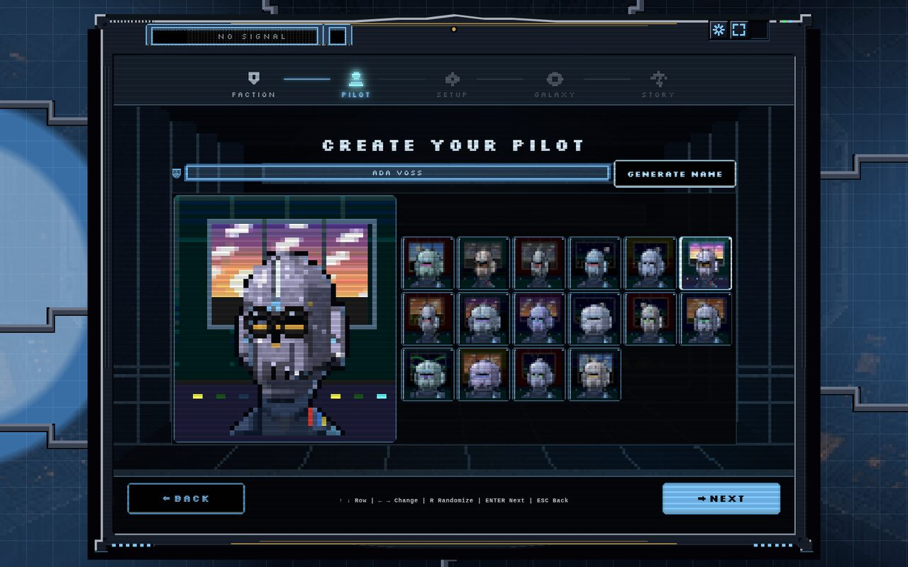 |
| Mission start | Launch hatch |
| 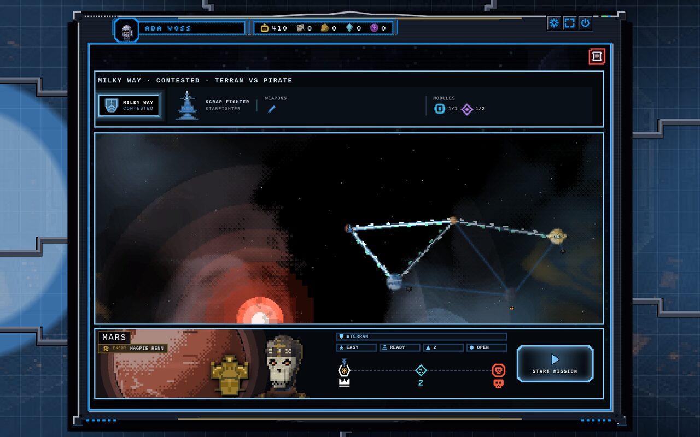 |  |
| Home Station | Galaxy travel |
|:---:|:---:|
| 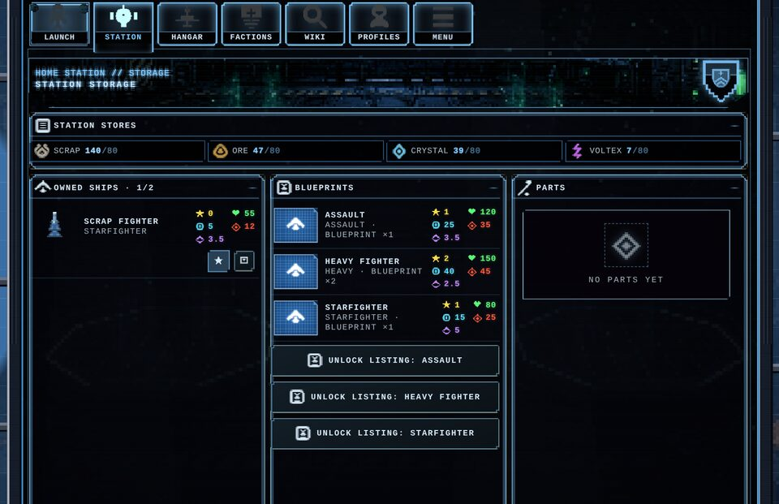 | 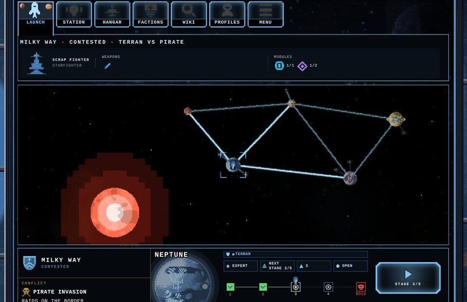 |
| Upgrade tree | Combat focus |
| 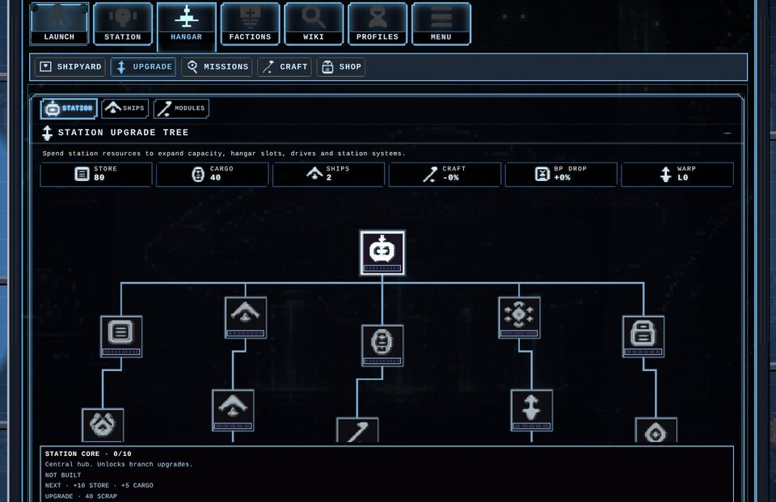 | 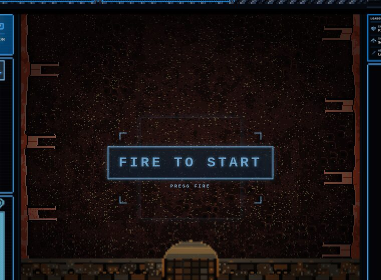 |
| Factions (hi-res emblems) | Emblem strip |
|  |  |

<br/>


<br/>


<br/>


<br/>

**Play:** [meierdesigns.itch.io/glxee](https://meierdesigns.itch.io/glxee)

</div>

## Features

Short index — the full systems live in the sections above.

- Five factions / galaxies: relations, contracts, trade, fleet preview, universe save.
- Home Station war-room: upgrade, hangar, equipment bay, shop, craft, missions, PLAY.
- Station vault + ship storage; chamber silos; physical item casings; equip animations.
- Shared `.vf-glass` bezel host for station, menus, and fight.
- Modular loadouts, area pager, hangar inventory, VOXEL combat with field presence.
- Full-screen start menu with the pilot's station as living backdrop.
- Galaxy explore: shared pixel grid, stored nebulae, checkpoints, traffic, ship locator.
- 4:3 stage, faction bezel, pilot HUD, PERF / DEBUG / AUDIO remote, boot loading screen.
- Launch hatch and sluice exit; chain waves; prism / bulwark; salvage pickups.
- Victory trader for the next stage; enemy hero cards; side-view weapon cards.
- VF Tracker BGM: planet×role Hauptmelodien (ingame/map/victory/lose/shop/boss), STYLE + scene feel (difficulty/tier); faction skins, crossfade, Soundtrack Editor.
- Coded environment SFX: sluice / hatch / warp, breaks, pickups, wall scrape.
- Gamepad focus cursor: combat, menus, fire-to-start, end-screen confirm.
- Local HTTP/1.1 `npm start`; end screens restore across refresh; optional ComfyUI.

### Current build focus

```text
AUDIO   ── STYLE · AMOUNT · SPEED · voices ── planet×faction vftrack ── crossfade ── env SFX
   │
SHELL   ── shared .vf-glass host ── undivided bezel opening ── header peek
   │
SALVAGE ── wreck blueprint/part pickups ── death forfeit ── victory teleport
   │
TRADE   ── victory-screen shop ── docked post same chrome ── category skins ── next-stage inventory
   │
STAGE   ── launch hatch ── sluice gate exit ── faction tube / dome styles
   │
WAVES   ── chain paths ── hangar launches ── cover AI ── prism / bulwark
   │
HUD     ── enemy hero cards ── reacting portraits ── weapon art cards
   │
PERF    ── hot-path bake ── parallax plates ── remote FPS / LOOP / heap
   │
MAP     ── one pixel unit ── stored nebula ── posterised steps ── lighter zoom
```

Build **1.14.12** rewrites planet Hauptmelodien, hardens Jungle / DnB kit ownership,
raises BASS / LEAD / ARP / DRUMS to **300%** with live bus + instant revoice, and
keeps note body when MUSIC BPM speeds up — on top of the 1.14.11 anatomy modal,
hub gate, and hangar polish.


## Architecture

GLXEE deliberately remains a script-loaded browser project. Large systems are
split into focused folders while their public entry points remain stable.

```text
index.html                 dependency-ordered entry point
css/styles/part-*.css      pixel UI, station, hangar, and faction chrome
css/                       fonts, screen-frame, pilot-hud, variables, asset-gen

js/core/                   state, configs, stage-boot, boot-loader, viewport-fit, loop
js/game/                   player, enemies, bullets, collisions, obstacles, audio
js/game/tracker/           vftrack JSON chiptune parse / player / defaults / manager
js/graphics/               sprites, palettes, silhouettes, effects, renderers
js/ui/                     station, hangar, editors, viewers, maps, menus
js/abilities/              ability definitions and player abilities
assets/                    fonts, sprites, ship models, modules, levels, metadata
assets/soundtracks/        vftrack template + LLM prompt for Gemini-style editors

docs/                      architecture, technical notes, updates, devlogs
rules/                     game rules and tactical design notes
tools/                     HTTP/1.1 dev-server, ComfyUI, asset-gen, icon-preview
packages/                  Cursed IDE packages
```

### Module convention

A large system such as `js/ui/home-station.js` keeps its entry point and stores
focused methods in `js/ui/home-station/`:

```text
js/ui/home-station/core.js
js/ui/home-station/render-hangar-tab.js
js/ui/home-station/hangar-parts-grid.js
js/ui/home-station/area-upgrades.js
js/ui/home-station.js
```

`core.js` establishes the class. The focused files extend it with
`extendClass(...)`. `index.html` loads the parts in dependency order, followed
by the entry file. ES modules such as the ship asset loader import their own
parts.

Keep new methods near related methods and split a file before it becomes hard
to review: script files stay under about 500 lines. Oversized files are split
into `<name>.js` plus `<name>-part2.js`, `-part3.js` … (same `extendClass` /
`Object.assign` call, members unchanged); class cores keep constructor, statics,
and private members. `js/core/viewport-fit*.js` (bezel, FX plate, stage layout)
has no class: each part is its own closure and shares one private scope object,
`window.vfFitScope` (functions and constants exported by name, the former
closure-wide `let`s on `vfs`). Parts load in order, so load-time code may only
use helpers declared in the same or an earlier part; nothing else is global. Runtime data follows the same pattern in config, sprite, and
profile-manager folders.


## Development waves

Changes are committed by feature so each slice has a readable history and can
be reviewed or reverted independently.

| Wave | Feature | Scope |
|:-----|:--------|:------|
| 39A–39E | Runtime modularization | Core, combat, graphics, UI, shell, and docs split into focused modules |
| 40A–40C | Anatomy and station controls | Voxel hulls, hangar editing, dialogs, themes, and navigation |
| 41A–41D | Rendering, travel, combat, commerce | Scale2x ships, galaxy travel, combat progression, trading posts, cosmetics |
| 42A–42C | Area and armament systems | Hull areas, Parts workspace, slot mounting, faction weapons, hangar polish |
| 43A | Loadout integration | Slot sizes, weapon mounts, ability integration, faction hull builders |
| 43B | Missions and relations | Mission board, faction reputation, contracts, bounty hunts, trade terms |
| 43C | Station mission UI | Missions, faction relations, faction trade, contract tabs, hangar slot bar |
| 44A | Galactic control | Faction holdings, expanding stations, base raids, invasions, contested galaxies |
| 44B | Combat presentation | Weapon slot purchases, bounded mounts, full-sprite weapons, collision-safe placement |
| 44C | Station UX | Resizable sidebars, hangar layout polish, profile flow, palette and menu refinements |
| 45A | Combat staging | Enemy lanes, victory handoff, loot timing, pickup and collision polish |
| 45B | Galaxy routing | Arrival sectors, route preview, galaxy state, and parallax handoff refinements |
| 45C | Hangar presentation | Power budget, slot fit states, parts presentation, and test-arena polish |
| 47A | Pilot readouts | Profile scoring, ability stats, combat progression, and loadout feedback |
| 47B | Planet theaters | Galaxy navigation, animated planet frames, and faction visual treatments |
| 47C | Station presentation | Fleet previews, HD navigation icons, start intro, and hangar shell polish |
| 48C–48K | Shell zoom era | 75% GUI baseline, browser zoom coexistence, responsive viewport fit, `.vf-browser-shell` |
| 49A | README visual refresh | Live sprite strips for fleet, planets, and weapons plus updated terminal banner chrome |
| 49B | Live README screenshots | Capture station, factions, galaxy travel, and Mars combat into the GitHub archive |
| 50 | Live README strips | Replace old planet/weapon/ship gallery sprites with combat-renderer and SVG exports |
| 51A | Hi-res emblems | Hand-shaded 32×32 faction emblems and resource icons on the `@2x`/`@4x` path |
| 51B | Zoom-safe pointers | Patch CSS-zoom rect drift so hit tests match visual pixels across engines |
| 51C | Scrolling terrain | Destructible rocks, debris, planet-tinted walls, and flight-lane patterns |
| 51D | Bosses and planet tiers | Difficulty curve, multiphase bosses, ambush flavours, enemy steering |
| 51E | Supply crates | Timed power-shot crates, boosted bullet glow, and faster victory scoop |
| 51F | Galaxy explore polish | Faction station borders, stage progress, and explore-map refinements |
| 51G | Station and HUD polish | Weapon keys, shield vitals, hangar tips, and combat info panel readability |
| 51H | README wave archive | Hi-res emblem screenshots and expanded combat/docs for waves 51A–51G |
| 51I | Live screenshot refresh | Recapture station, upgrade, galaxy, factions, and Mars combat with terrain |
| 52A | PLAY launch | Dedicated header/menu PLAY control; remove PLAY from station sub-tabs |
| 52B | Border checkpoints | Faction silhouette borders, fly/dock/raid/assault confirms, planet atmo haze |
| 52C | Station and map chrome | Area-tab corner deco, faction station fills, selection frames, PLAY styling |
| 52D | README travel archive | Document PLAY launch, border actions, and explore-map chrome for waves 52A–52C |
| 53A | Shared world ownership | Global planet owners, galaxy generation, warp tiers, control presets |
| 53B | Invasions and liveries | Ally defense invasions, renegade/gang contracts, seeded enemy paint |
| 53C | Multi power-ups | Crate drops for power shot, rapid fire, and barrier with HUD cues |
| 53D | Stage progression | Variable stage counts, stage-scaled terrain, victory/defeat outcome stepper |
| 53E | GALAXIES viewer | Main-menu galaxy browser and custom start-galaxy creation modal |
| 53F | Explore map sync | Ownership/invasion cues, battle marks, and travel confirm polish |
| 53G | Shell chrome | Fullscreen toggle, game-over wreck, reload keys, and UI styling |
| 53H | README world archive | Document shared world, power-ups, stages, and GALAXIES for waves 53A–53G |
| 54A | Pirate emblem | Angular void-skull boarding seal at 16px and hi-res `@4x` |
| 54B | GUI scale slider | Persistent 50–125% shell zoom via frame slider and uiAppearance |
| 54C | Map traffic and locator | Bidirectional route packets, ship locator, zoom detail, barrier depth |
| 54D | Faction fleet zoom | Fleet preview zoom controls and accented faction-viewer emblems |
| 54E | Hangar edge drag | Pointer-locked frame resize at every existing scale |
| 54F | Map and station chrome | GUI slider, ship locator, traffic, fleet zoom, and viewer accents |
| 54G | README map polish | Document pirate seal, GUI slider, locator, and fleet zoom for 54A–54F |
| 55A | Boot noise quiet | FOUC zoom, AudioContext, and YouTube cookie console noise |
| 55B | Module cost ramp | Stronger late-level area and slot upgrade prices |
| 55C | Hit explosion shrink | Compact hit bursts for clearer combat silhouette feedback |
| 55D | Size settings overlay | Enemy, player, and shot size steps with in-game SIZE overlay |
| 55E | Champion boss kits | Split side-boss difficulty and faction-specific boss kits |
| 56A | Local fonts and server | Self-hosted Silkscreen, boot veil, revalidating `npm start` |
| 56B | Playfield-first viewport | Fight canvas fills column height; leftover width feeds side HUD |
| 56C | VOXEL combat lattice | Shared cell size, lower supersample, silhouette voxel debris |
| 56D | Exact sizes and borders | Pixel width/speed overlay, thicker borders, FX percent strength |
| 56E | Crystal terrain | Crystal/metal/magma materials, prism obstacles, shatter shards |
| 56F | Menu and profile chrome | NEW PILOT, locked LOAD, HD icons, profile tiles, progress bars |
| 56G | Map ruler and universe | Explore chip, stage ruler bar, galaxy viewer state, universe JSON |
| 56H | Station builders | Trading-post builder memory, edge-aware posts, column resize |
| 56I | Combat entry polish | Dive-in spawns, faster victory scoop, loot idle vacuum |
| 56J | README archive | Document boot, VOXEL fight, sizes, crystals, and universe for 55–56 |
| 57A | Fixed stage bezel | 4:3 logical stage, faction bezel, RES slider, pre-paint `stage-boot` |
| 57B | Hangar area pager | One open hull area at a time; pinned prev/next above the ship list |
| 57C | Hangar bay zoom | Whole-pixel zoom steps above 1×; smooth shrink to 12 % below |
| 57D | Pilot flow restore | Resume unfinished New Pilot faction/name steps after reload |
| 57E | Combat present polish | Fine rock fireballs, wreck fly-in lane, VOXEL default |
| 57F | README stage archive | Document stage bezel, hangar pager, and zoom for waves 57A–57E |
| 58A | Stage window fill | Scale the 4:3 stage to 95 % of the window in boot and viewport-fit |
| 58B | Station tab align | Align tab/PLAY row to content; skip redundant nav tooltips |
| 58C | Side enemy cull | Drop off-screen side enemies so HUD bars and clear checks finish |
| 58D | PLAY shell chrome | Calmer PLAY frames, nav cards without inset glow rings |
| 58E | README station archive | Document 95 % fill, tab align, and PLAY chrome for 58A–58D |
| 59A | Boot loading screen | First-paint progress panel with resource phases until menu restore |
| 59B | HTTP/1.1 dev server | Keep-alive, quiet logs, daemon threads for hundreds of static files |
| 59C | Screen frame and HUD | Shared `--fr-shape` bezel plates plus split pilot crest/resource screens |
| 59D | Calm refresh veil | Hide progress panel on same-tab refresh; keep bezel above the cover |
| 59E | Sub-nav body bridge | Active area card opens into the body when no sub-nav exists |
| 59F | README frame archive | Document screen-frame, pilot HUD, and calm refresh for 59B–59E |
| 60A | Field presence combat | On-screen-only shots/roles, hard flee kick, stop sides after win |
| 60B | README cleanup | Trim Features index; document field presence for wave 60A |
| 61A | Pixel frame and FX plate | Raster bezel lattice, frame style editor, bezel FX tool, typed colour fades |
| 61B | Look FX expand | Vignette/noise/flicker/bloom/HDR, GUI voxel, finer Voxel Size, font/game scales |
| 61C | Map pixel nebulae | Shared map pixel unit, tiled nebula patches, sun-gated swirls |
| 61D | Fleet preview player | Pilot ship in faction preview, live colour overrides, player-only filter |
| 61E | End screen restore | Persist and restore victory/game-over across refresh |
| 61F | Shot sweep and terrain | Bullet sweep hit tests; boss arenas keep scrolling terrain |
| 61G | README look archive | Document pixel frame, FX, map, fleet preview; compress shell-zoom wave rows |
| 62A | Stored nebula and map pixel | One map pixel unit, stored/prewarmed nebula, posterised steps, lighter zoom |
| 62B | Boot and map return | Fight screen hidden until shown; map opens on the fought planet |
| 62C | Combat sweep and spawns | Swept shot hits, scheduled spawns, editor shot preview, playfield defaults |
| 62D | HUD rework | Level info HUD, tooltips, pilot HUD |
| 62E | Bezel and look polish | Pause screen in the glass, victory/pause layering, icons, start-screen fonts |
| 62F | Station and editors | Station tabs, editors, economy stats, ship asset sprites |
| 62G | README map archive | Document nebula storage, map pixel unit, boot and map-return behaviour |
| 63A | Map routes and stations | Detour arcs around obstacles, per-galaxy camera and selection, orbiting stations, JUMP TO unlock hint |
| 63B | Pilot creator | Pilot step with generated helmet portrait and sliders, galaxy icon, startup sound, faction card layout |
| 63C | Station and perf | Faction hero portraits, contract weapon rewards, PERF switches, calmer hangar parts, explosion loot timing |
| 63D | README pilot archive | Document map routes, pilot creator and the 63A–63C changes |
| 63E | Cold load vs refresh | `data-vf-load`, background preload, immutable `?v=` cache headers, trimmed CSS |
| 63F | FX scan sliders | Scan size, speed and warp in the FX plate |
| 63G | Script split | Oversized scripts split into parts under about 500 lines |
| 63H | Viewport-fit split | `viewport-fit` parts under 500 lines |
| 63I | Viewport-fit scope | Parts share `window.vfFitScope` instead of globals |
| 63J | Runtime performance | Cached terrain rows and layers, pixel-written layers, cheaper hangar preview |
| 64C | Faction and hangar integration | Faction hull topology, ship variants, profile kits, hangar physical items, tooltips, and loadout presentation |
| 64A | Hangar and selection polish | Remove the redundant hangar area bar; stabilize faction-styled planet selection indicators and zoom rendering |
| 64B | Hangar inventory | Inventory panel, physical items, kind filters, equip / hover animations, compact tooltips |
| 64C | Ship hulls | Faction hull builders, paint topology, voxel grids, lit bounds, shield hull |
| 64D | Start screen | Station backdrop menu, darker backgrounds, raised menu buttons |
| 64E | Repo footprint | Tracked files under 800; local bridge packages and unused sprite dumps ignored |
| 65A | Faction terrain doctrine | Organic/mechanical floor patterns, faction wall silhouettes, planet+holder blend |
| 65B | README media restore | Restore `assets/ui/readme-*` banners, shots, strips, and live icon plates for GitHub |
| 65C | README screenshot refresh | Live `-65c` shots; drop unused hero/live plates and stale header media |
| 65D | README ship strips | Rebuild faction assault and Terran class strips from live `factionShipStyles` |
| 66A | Start-profile story paths | Each start profile offers 1–3 lore-matched stories with mission chains; wizard STORY step replaces planet pick |
| 66B | Runtime smoothness | Cap map planet spin detail, round-robin spin ticks, stop HUD full rebuilds, pause hidden canvas loops, wire PERFORMANCE MODE |
| 66C | Smoothness same quality | Combat HUD write-skip, hangar preview 30fps, bg-parallax layer cache + combat pause, tab-hidden game loop |
| 66D | Map planet + nebula restore | Fix spin upgrade stuck on SVG cull; target detail in spin attr; nebula fine patches mount only when ready |
| 66E | Nebula + planet sharpness | Fine nebula alpha (no black plate); density in playable band; brighter veils; screen-aware planet detail ≤24 |
| 66F | Map planet perf | Map nodes detail ≤8 (~2.5 CSS px/cell); tighter spin budget |
| 66G | Travel zoom stick | adoptViewBoxZoom on fly start/arrival; defer cam mapZoom until glide ends |
| 66H | Launch cutscene skip race | Defer cutscene + 500ms skip arm so START Enter does not skip instantly |
| 66I | Launch cutscene visible | HeroPlanetBackdrop no longer forces relative (0×0); cutscene z-index 100090 |
| 66J | Story cutscenes | Launch cutscene styles per story (hunt/escort/raid/salvage/rift/compile/…); title card |
| 66K | Cutscene title readable | Title/blurb stay up through act; canvas stroke text + high-contrast card |
| 66C | Mission logbook | Main quest from story path; sidequests at stations/planets; targets = planet, station, locate, or find galaxy |
| 66L | Enemy card poster | Planet title, emblem + hero name frames, backdrop-free portrait, dev layout modal (position, size, layer, defaults) |
| 67A | Natural terrain carve | Organic floor ridges, torn wall craters, less grid/stripe doctrine on planet crust |
| 67B | Block terrain dig | Wall damage in 3-cell voxel slabs — flat block faces, no 1-row carve needles |
| 67C | Game-over fit | Compact defeat planet/stepper, softer wreck backdrop, scrollable card |
| 67D | Map route line zoom | Under Global Pixel Size, route beams stay N screen cells thick instead of growing chunky when zoomed in |
| 67E | Story cutscene sources | Track story-paths, launch cutscene, and hero-planet modules as first-class sources |
| 67F | Mission logbook sources | Mission log module, station missions tab, and objective wiring for story sidequests |
| 67G | HUD layout editor | Dev layout editor for combat HUD panels with per-slot size and font scales |
| 67H | Home station polish | Station shell layout, hangar preview, navigation, and sidebars |
| 67I | Combat spawn polish | Wave director, side enemies, shot bursts, and hit-profile tweaks |
| 67J | Viewport and appearance | Viewport-fit plate polish, GUI appearance hooks, start-screen and parallax |
| 67K | Editors and hull polish | Ship/enemy editor glass, procedural component gen, hull builders, sprite loader |
| 67L | Repo footprint trim | Drop faction _reference art and legacy js/levels; ignore local archive/ |
| 67M | Brand logos and PORT | Meierdesigns brand SVGs and PORT-aware npm start scripts |
| 67N | Deferred bundle rebuild | Rebuild deferred.js and index cache keys for waves 67A–67M |
| 67O | Menu FPS park | Idle combat RAF until fight; 2× playfield + 200k px cap; throttle fleet/hangar/spin; map px filter only when PERF heavy ON |
| 67P | Remote perf probe | PERF/DEBUG live FPS, frame ms, loop, backing, heap, entities; LOG/COPY PERF + vfPerfSnapshot |
| 67Q | README perf remote | Document bezel PERF/DEBUG probe, presets, and vfPerfSnapshot in the README |
| 68A | Launch hatch and sluice | Station launch tube on arrival, faction-styled sluice gate exit with shootable hatch dome |
| 68B | Combat waves and obstacles | Chain waves, hangar launches, cover AI, prism / bulwark obstacles, wall scrape, crate and pickup polish |
| 68C | Enemy hero cards | Sidebar cards with unique reacting portraits; side-view weapon cards with charge cells |
| 68D | Shell and map polish | Viewport-fit fixed map aspect, resize hold, pilot thumbnail, galaxy map controls, start screen portraits |
| 68E | Deferred bundle rebuild | Rebuild deferred.js and index cache keys for waves 68A–68D |
| 68F | README stage archive | Live `-68a` shots: pilot wizard, mission start, launch hatch, combat hero card |
| 68G | HUD remote move/scale | Second fernbedienung (HUD · OUTSIDE): drag header, corner resize, zoom slider; geom/zoom persisted |
| 68H | Voidborn vine bezel | Continuous rim 9-slice tentacle corners; top mid thickener only; vine SVG assets |
| 68I | Map lane whisper | Planet-to-planet lines always visible at very low opacity |
| 68J | Voidborn bezel stay | Vine rim no longer vanishes (border fallback, no pixel-frame cull, clip after voxel) |
| 68K | In-stage shop kiosk | Shop beside sluice gates with procedural shopkeeper face, credits-only trades |
| 68L | Controller support | Gamepad fire-to-start, victory/game-over menu navigation, planet-selection input routing |
| 68M | Combat balance TTK | Role-budget weapons, difficulty/stage/shop curves, TTK enemy HP, balance-config module |
| 68N | Soundtrack editor | Dev-mode overlay assigns a YouTube URL or local audio file per stage / enemy type, overriding the planet track with enemy > stage > planet priority |
| 68O | Ship storage | Per-ship "on this ship vs at the station" filing overlay on owned parts/blueprints, independent of equip/ownership ledgers |
| 68P | Physical item art | Seeded generative metal-casing render (bevel, rivets, vents, hazard stripes, scratches) for every inventory part icon |
| 68Q | Station column resize fix | Hangar/blueprint/parts columns keep a readable minimum width and resize handles track correctly under GUI zoom |
| 68R | DevMode hover screen | Bottom bezel screen names the element under the pointer (selector, label, size) while DevMode is on |
| 68S | DevMode hover highlight | HI toggle on the hover screen; with mode on, hold Shift to tint/outline the hovered element |
| 68T | Station storage columns | Fix post-refresh layout: resize matches the 2-column storage|stores grid instead of legacy 3-fr weights |
| 68U | Profile vault bay size | Station Storage grid starts at 6×2 and grows with vault upgrades (`storageSlots`) |
| 68V | Station stores label fix | Chamber tag icon sized to the label font (1em) and aligned inline beside the text |
| 68W | Station side-by-side rule | Light vertical accent line between OWNED SHIPS and STATION STORAGE in side layout |
| 68X | Owned-ship active button | Drop the ACTIVE/SET ACTIVE star control from the OWNED SHIPS row (hangar keeps it) |
| 68Y | Gamepad focus cursor | Animated HUD cursor jumps between focused buttons while the controller drives menus |
| 68Z | Ship stats over name | OWNED SHIPS stats sit in one horizontal row above the ship name label |
| 69A | FX audio remote | AUDIO tab on the bezel FX remote: master/sounds/music sliders plus sound and music toggles |
| 69B | Ship card layout | Owned-ship cards put Ship Storage beside the ship row; station grid prioritizes ships then bay |
| 69C | Storage slot frame | Ship/station bay cells share one square `--cs`; outer bay border + pad so storage edges read clearly |
| 69D | Station chamber silos | Level fill surfaces, full resource labels in-flow, aspect-locked silo tubes, capacity Grenze mark |
| 69E | Equipment bay upgrades | Per-item upgrade detail in Home Station EQUIPMENT with station/ship storage select mode |
| 69F | Gamepad HUD cursor | Animated focus cursor for controller menu navigation (`gamepad/cursor.js`) |
| 69G | Epic README pass | Sharper VOLTEX identity copy, lore stakes, and wave ledger cleanup for GitHub |
| 70A | Combat FX smoothness | Screen-sized FX layers (same look), cheaper bullet/shield proximity, swap-remove particles/debris, once-per-frame drag/voxel sticky |
| 70B | Combat hot-path bake | Parallax tile/grid bake+blit, cached explosion rings + boss vignette, frame-sticky render scale, skip FX snapWorld |
| 70C | Parallax planet plates | Bake dense planet BG patterns, freeze layer plate on boss stages, logical clear, swap-pop bullets/stars |
| 70D | Bezel glass screen | Shared `.vf-glass` host for station/menus/fight: one transform recipe, undivided opening insets, header peek under bezel |
| 70E | Victory shop button | Stage trader opens from the victory screen; sluice-wall kiosk removed; buys queue for the next stage |
| 70F | VF Tracker soundtracks | JSON chiptune player replaces drone BGM; planet defaults; Soundtrack Editor import/export + LLM prompt (`assets/soundtracks/`) |
| 70G | Tracker music live | Audible music bus, gesture resume, station/menu restore, planet+boss vftrack files under `assets/soundtracks/` |
| 70H | Faction + end themes | Combat vftracks compose planet×hostile faction; distinct victory/lose loops per faction |
| 70I | Environment SFX | Coded Web Audio for sluice/hatch/warp, rocks/shields/crystals, pickups, wall scrape (`sounds/env-sfx.js`) |
| 70J | Music volume fix | Linear MASTER×MUSIC bus, migrate tiny defaults, force planet vftrack on stage boot |
| 70K | Tracker arrangement variety | Multi-section planet/menu/boss loops (A/B/C/fill), per-pattern faction drums, victory/lose bridges |
| 70L | Salvage pickups | Enemy blueprint/part drops spawn as world pickups into cargo; death forfeits them; victory teleports to station |
| 70M | Mission intro fanfare | *(superseded by 72J)* was one-shot `intro:` before combat — caused a hard track jump |
| 70N | Per-planet soundtrack | Explored planets remix handcrafted motifs (blend/key/order); no random-note BGM |
| 70O | VF GB soundtrack | Tracks oriented on Volley Fire GB (1990): pulse/wave/noise palette, Main-BGM/Boss/Select roles |
| 70P | Motivic BGM | Planet themes state→sequence→climax; intro/boss reuse motif; remix keeps one donor intact |
| 70Q | In-stage shop grids | Smaller cells (40px), tighter panel gaps; shop ship/station bags force 1×1 tiles + 6-col station |
| 70R | README audio archive | Document VF Tracker, env SFX, glass shell, salvage, victory trader; VOLTEX panel + build focus for 70A–70Q |
| 70S | Docked trader modal | Galaxy trading-post dock opens a fullscreen victory-trader modal; parts/ships/BP/resources/portals/styles each have their own stock skin |
| 70T | Music jump fix | Tracker skips overdue rows after stalls; same song keeps position across stage/override swaps; enemy-type churn no longer retriggers BGM |
| 70U | Music crossfade | Track swaps (~0.85s) crossfade via dual tracker/local buses instead of hard cuts |
| 70V | Remote music mix | FX remote AUDIO tab: bass/lead/arp/drums + crossfade; longer default fade (~1.4s) |
| 70W | Music BPM control | Replace ×-speed with absolute MUSIC BPM (default 462 ≈ old 3.5× @ 132) |
| 70X | Jungle / DnB morph | AUDIO slider: breakbeat layer, bass/drum mix push, tempo toward ~560 sequencer BPM |
| 70Y | Melody themes | THEME regulator: PLANET / AMEN / REESE / NEURO / LIQUID heads + denser Amen break / Reese twin |
| 70Z | Channel voice dropdowns | BASS / LEAD / ARP / DRUMS become sound selects (remote AUDIO + settings) instead of mix sliders |
| 71B | Bipolar DnB/Jungle | Style slider: left DnB, center OFF, right Jungle; stronger two-step vs Amen-chop morph |
| 71A | Faction boss doctrines | Five faction bosses: distinct movement, attack rotations, and specials (barrage / scatter / dive / salvo / ring+blink) |
| 71C | Music style dropdown | STYLE select (incl. JUNGLE DNB + MINIMAL ELEKTRO) + AMOUNT intensity 0–100% on settings and FX AUDIO remote |
| 71D | Theme on all tracks | THEME (AMEN/…) heads + breaks persist across planet / menu / intro / combat swaps; no longer gated behind AMOUNT |
| 71E | More music styles | JUNGLE + DNB split (stronger heads/breaks), MINIMAL groove rewrite, NIGHTRUN darksynth style |
| 71F | Dark minimal techno | MINIMAL retuned to Max Minimal–style dark techno: pumping 4/4 sub, delayed stabs, hard kit |
| 71G | Music voice sliders | BASS / LEAD / ARP / DRUMS: more presets; dropdowns become option sliders with volume still on the right |
| 71H | Shop stock by standing | Victory trader shelves roll larger/random per visit from planet-resident faction relation; bigger cells |
| 71I | Launch map controller | Stable planet arrows (resting posts), ↓ into card/stages, ↓ from LAUNCH into map, no false start on Liberated |
| 71J | Gamepad shoulder fire | LB/RB/LT/RT map to A/S/D/Space; L3 boost; R3 shot-type cycle; analog trigger press |
| 71K | Corridor stage perf | Cache wall silhouettes, split floor/wall lattice rebuilds, cheaper fog noise + stepped fills |
| 71L | Release 1.14.4 | GitHub README audio/STYLE docs + local `.claude/GLXEE-V1.14.4.zip` runtime archive |
| 71M | Mute volume trio | Bezel mute dropdown shows VOL + SND + MUS sliders (master / sounds / music) |
| 71N | Release 1.14.5 | GitHub push + `.claude/GLXEE-V1.14.5.zip` with mute volume trio |
| 71O | README media refresh | New cinematic `readme-banner.jpg`; live `-71o` combat / faction-command shots |
| 71P | Music loop stability | Tempo-anchored tracker schedule, RAF pump, milder stall skip; STYLE heads actually replace bass/lead/arp |
| 71Q | Dev music editor | DevMode MUSIC tab: STEPS/BARS/PACKS zoom, pack reorder/copy, live playhead (`js/ui/dev/`, not uploaded) |
| 71R | Menu AUDIO tab | Sound + music leave SETTINGS; dedicated ESC-menu AUDIO tab (volumes, toggles, soundtrack, editors) |
| 71S | Music editor drums | STYLE score shows 4th DRUMS strand; theme banks/player can override drums when set |
| 71S | Esc menu layout guard | Ignore Esc key-repeat, cooldown after menu close, no hangar soft-park, stale soft-mount rAFs no-op |
| 71T | Esc menu hard remount | Menu open/close forces shell rebuild; station column RO disconnects so 0-width park cannot trash the grid |
| 71U | Music editor on remote | Drop ESC MUSIC tab; DevMode Music Editor is a bezel MUSIC tab + AUDIO widen split (settings \| editor) |
| 71V | AUDIO split resize | Drag the settings\|editor border on the wide AUDIO remote; width persisted (dbl-click resets) |
| 71W | Voice pick + vol | AUDIO remote BASS/LEAD/ARP/DRUMS keep dropdowns and gain option sliders; channel volume faders shrink |
| 71X | Drop MUSIC tab | Remove redundant bezel MUSIC tab; DevMode Music Editor only via AUDIO widen split |
| 71Y | Voice vol hover % | Channel volume % only on hover/focus; volume column widens into the freed readout space |
| 71Z | Music speed readout | Show MUSIC SPEED as × (not raw 444 BPM); playback uses authored×scale again |
| 72A | Melody × STYLE | Planet roles ingame/map/victory/lose own Hauptmelodien; STYLE interprets rhythm/drums instead of replacing hooks |
| 72B | Distinct motifs | Planets get unique rhythms (march/syncop/gallop/half-time/clusters); map/victory/lose rebuilt as ambient/fanfare/fade; STYLE remaps lead hard |
| 72C | Music level lock | Master compressor + soft ceiling; balanced STYLE mixes; break/drum ducking; capped note/twin peaks |
| 72D | Music switch fix | Same-role hops soft in-place (no stacked crossfade); map music debounced; menu won't yank open map BGM |
| 72E | Style soften + tempo | STYLE only tints song (no rhythm rebuild); milder breaks; tempo auto-fits style×authored BPM |
| 72E | AUDIO editor always | DevMode Music Editor on narrow AUDIO remotes too (stack); wide stays side-by-side; collapse still editor-only |
| 72F | Transit rail events | Slim tube progress rail; scheduled contact ticks (role accent) along the reachGoal track |
| 72G | Transit reveal icons | Wider rail; contact icons animate in on the right once an event is known / announced |
| 72H | Music scene adapt | Victory/defeat/shop/map motifs; difficulty+planet-tier feel; dual crossfade on planet hops; end screens keep the bus |
| 72I | Boss Hauptmelodien | Per-planet boss siege motifs (Dust/Giant/Ring/Ice/Kuiper) — separate DNA from combat loops |
| 72J | No music track jump | Stage boot skips intro fanfare (direct combat crossfade); mid-fight enemy overrides no longer swap the song |
| 72K | Music Editor WYSIWYG | PREVIEW plays the STYLE bank on screen (not planet BGM); playhead ignores live game music |
| 72L | Kill intro fanfare | playIntro no-ops; stage boot no hard music stop; victory keeps combat loop (no per-clear fanfare swap) |
| 72M | Music bug sweep | Restore volume after victory duck; disconnect zombie buses/limiters; heard BPM includes scene feel |
| 72N | Less repetitive BGM | Combat/boss loops expand to ~24-slot A/B/C/break/drop form (was 8-bar P0-heavy wheel) |
| 72O | Distinct boss BGM | Boss no longer keeps stage loop; *-boss keys + darker/faster faction skin |
| 72P | Controller display wake | Linux idle reset while gamepad connected: Wake Lock + `/__user-activity` D-Bus poke via dev-server |
| 72Q | Release 1.14.7 | GitHub push + `.claude/GLXEE-V1.14.7.zip` runtime archive (music scenes, UI, gamepad wake) |
| 72R | Firefox canvas smear | Gecko: drop CSS filter/radius on `#gameCanvas` under stage scale; hide SVG backdrop FX; poke layer after backing resize |
| 72S | Boot console quiet | No early layout read in stage-boot (FOUC); drop unused font/station preloads; warm BGs via Image() |
| 72T | Firefox canvas harden | Gecko: CRT off; opaque playfield ctx; theme via ctx.filter; class poke on resize |
| 73A | Ship audit + ignore | `npm run ship:audit`; tighten `.gitignore` (ZIPs/scratch); volume defaults quiet + consistent bus |
| 73B | Lazy editors bundle | Dev/Asset-Gen/viewers → `deferred-editors.js` via `ensureVfEditors`; core boot stays leaner |
| 73C | Station RAF unify | Hangar + fleet previews share `vfStationAnim` (one ticker) |
| 73D | PERF combat caps | Particle soft caps + lighting budget from PERF / performance mode |
| 73E | VFStorage facade | Shared get/set/JSON/schema helper; volume save routes through it |
| 73F | README media slim | Drop unused shots; compress + JPEG live shots (archive keeps PNG masters) |
| 73G | Release 1.14.8 | Deploy ZIP `.claude/GLXEE-V1.14.8.zip` — lazy editors, volume/PERF, slim README media |
| 73H | Combat frame smooth | Baked light glow sprites, reuse bullet-light/HUD/enemy-type buffers; no quality cuts |
| 73I | Release 1.14.9 | Deploy ZIP `.claude/GLXEE-V1.14.9.zip` — combat frame smooth (73H) |
| 73J | Session slowdown fix | Single game-loop RAF; reuse SFX noise buffers + node release; cap ring/hit/terrain/pattern caches |
| 73K | Combat object pools | Pool particles/debris/flashes/voxels/bursts/bullets; cache debris colours; scratch splash list |
| 73L | Smooth pilot thrust | Player ship moves on continuous velocity (no VOXEL cell teleports); lattice snap stays for FX/enemies |
| 73M | Map right-click fly | Always animate map travel (no reduced-motion teleport); SVG NS ship marker; closer hit target |
| 73N | Release 1.14.10 | Deploy ZIP `.claude/GLXEE-V1.14.10.zip` — smooth pilot, map fly, combat pools (73J–73M) |
| 73O | Ship anatomy + hangar | Floating anatomy modal from ship thumbs; station/hangar layout, slot dots, inventory polish |
| 73P | Early hub gate | LAUNCH always visible; Hangar/Factions/Wiki after planet clear; Dev Mode italic preview + toggle anim |
| 73Q | Release 1.14.11 | Deploy ZIP `.claude/GLXEE-V1.14.11.zip` — anatomy modal, hub gate, hangar polish (73O–73P) |
| 73R | Pixel Size 1/2 perf | Tighter playfield backing at gp 1/2; FLAT ships stay sprites under GP; map detail cap; cheaper beams/bursts |
| 73S | Jungle / DnB punch | JUNGLE = Amen chops + ragga twin; DNB = two-step kit + half-time Reese sub; stronger breaks/mix/BPM |
| 73T | Jungle / DnB kit body | Kick pitch-drop, snare/hat filters, bass envelope morph, style drum strands, louder break oneshots |
| 73T | Laser flight fix | Shots move on continuous coords (no VOXEL stepMove freeze); clear pooled lattice acc; snap only at draw |
| 73U | Hauptmelodie clarity | Sparse GB hooks again; lead above arp; soften P1 clashes (Bb/F, no tritones) |
| 73V | Melody mix fix | Lead bus in front (was 0.55 vs arp 1.55); PLANET ignores AMOUNT morph; reset buried voice overrides |
| 73W | New Hauptmelodien | Rewrite planet/menu hooks as call–answer phrases (no triad walks); distinct rhythm per planet |
| 73X | Jungle / DnB fix | Amen/two-step own drums (no GB double-kit); Reese/chop morph; clear stale bank overrides |
| 73Y | Voice faders 300% | BASS/LEAD/ARP/DRUMS volume sliders (settings + FX remote) go to 300% |
| 73Z | Live drums / voices | Channel buses on fader move; poly drums; voice pick keeps wave under STYLE morph; instant revoice; FX vol won't wipe dropdown |
| 74A | Fast BPM body | Tempo reanchor keeps hook + cancels stale oneshots; ADSR/gates scale with row; softer note cuts |
| 74B | Release 1.14.12 | Deploy ZIP `.claude/GLXEE-V1.14.12.zip` — melodies, Jungle/DnB, live voices 300%, fast BPM body (73R–74A) |

The wave commit convention is:

```text
feat: <feature> wave <id>
docs: document <feature> wave <id>
```

## Documentation

- [Architecture](docs/ARCHITECTURE.md) — project layout and module conventions.
- [Technical notes](docs/TECHNICAL.md) — implementation details.
- [Update notes](docs/UPDATE_NOTES.md) — historical gameplay waves.
- [Devlog 1](docs/ITCH_DEVLOG_01.md) — faction silhouettes and combat identity.
- [Devlog 2](docs/ITCH_DEVLOG_02.md) — modular runtime refactor.
- [Devlog 3](docs/ITCH_DEVLOG_03.md) — living galaxies, hangar engineering, and the new GLXEE README style.
- [Git deployment strategy](docs/git-deployment-strategy.md) — feature-wave workflow.
- [Game rules](rules/game-rules.md) — design rules and tactical constraints.
- [Assets](assets/README.md) — asset database and generation notes.
- [ComfyUI / asset-gen](tools/comfyui/README.md) — optional asset tooling.

## Lore

In 2187 the first Voltex Crystal sang across a jump lane — and the quiet age
ended. What had been empty black became **contested ground**: every corridor a
prize, every station a claim, every silhouette on the scanner a doctrine with
teeth.

The **Terran Concord** hardens the Milky Way with escorts and engineered lanes.
**Kronax** packs carve Andromeda open with speed and ambush. **Voidborn** fleets
fold through cold rings and leave silence where maps used to be. **Pirate**
freebooters weld asymmetric scrap in the Belt and sell whatever still fires.
The **Machine Collective** expands the Synth Grid one forge node at a time —
logic without mercy, replication without rest.

Every faction hunts the same glowing dust. Pilots claim planets, sign pacts that
can flip a galaxy overnight, run contracts into rival space, and learn the only
rule that survives contact: **shape is doctrine** — not paint, not badge, not
promise.

For the full contact archive, see the faction entries in the update notes and
the [GLXEE devlogs](docs/).

## Credits

**GLXEE** — created by [meierdesigns](https://github.com/meierdesigns)

- Play: [meierdesigns.itch.io/glxee](https://meierdesigns.itch.io/glxee)
- License: MIT
- Runtime: browser · no build step · version **1.14.12** · intergalactic stakes
- Repository: [github.com/meierdesigns/GLXEE](https://github.com/meierdesigns/GLXEE)
